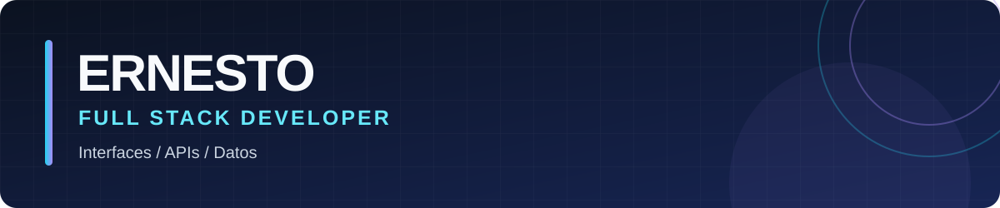

  

### Hola, soy Ernesto 👋

Desarrollo aplicaciones web de extremo a extremo: interfaces claras, APIs para procesos reales y datos que se pueden entender y auditar. Trabajo principalmente con **React, Next.js, TypeScript, Java, Spring Boot y PostgreSQL**.

I build web applications end to end, from usable interfaces to APIs and reliable data workflows. I am open to **Full Stack Developer** opportunities.

### Proyectos destacados · Selected work

- **[Transactions Operations Dashboard](https://github.com/Ernesto248/undertaker-transactions)** — Dashboard de operaciones financieras con Next.js y PostgreSQL. Incluye ingesta idempotente, libro de movimientos auditable, valoración FIFO y pruebas para flujos críticos. La aplicación desplegada requiere acceso, por lo que el repositorio documenta la arquitectura y las decisiones técnicas.
- **Jeni's Lashes & Brows** — [Frontend](https://github.com/Ernesto248/landing-cms-frontend) · [Backend](https://github.com/Ernesto248/landing-cms-backend) · [Sitio público](https://landing-cms-frontend.vercel.app). Plataforma de contenidos y reservas con Next.js en el frontend y una API Spring Boot con JWT, PostgreSQL, Flyway y pruebas. Las pantallas administrativas de la demo usan datos locales.
- **[Booking Copilot](https://github.com/Ernesto248/booking-copilot)** · [Demo](https://booking-copilot-sand.vercel.app) — MVP bilingüe para gestionar solicitudes, presupuestos y citas de artistas del tatuaje. Combina Next.js, Supabase y flujos asistidos por IA, con revisión humana de las decisiones.

### Tecnologías · Stack

`TypeScript` · `React` · `Next.js` · `Java` · `Spring Boot` · `PostgreSQL` · `Supabase` · `Tailwind CSS` · `Vitest` · `JUnit`

Los repositorios fijados muestran el código y la documentación de estos proyectos.
